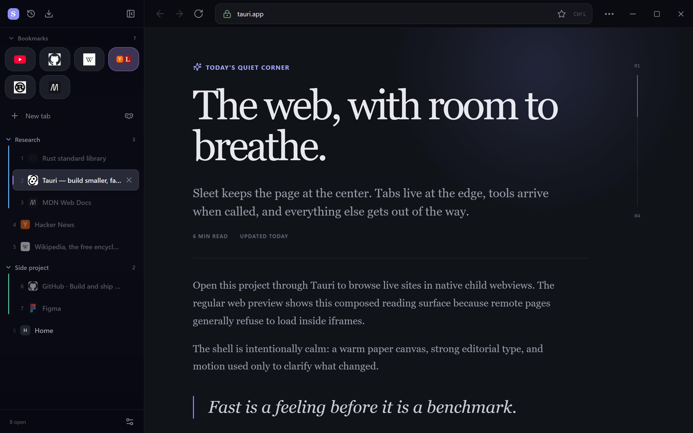
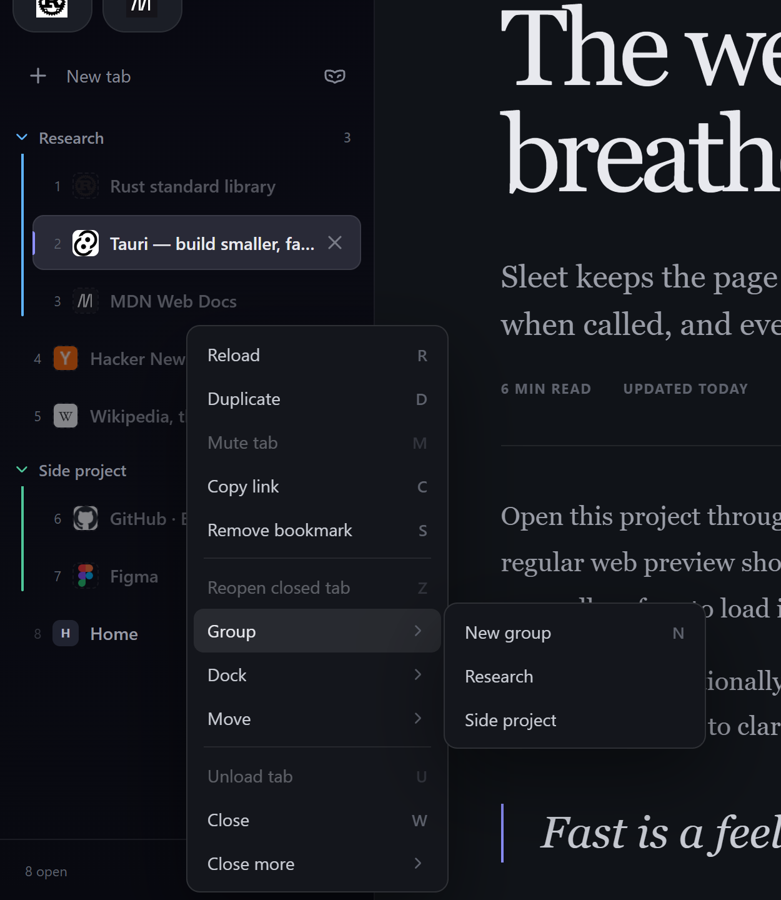
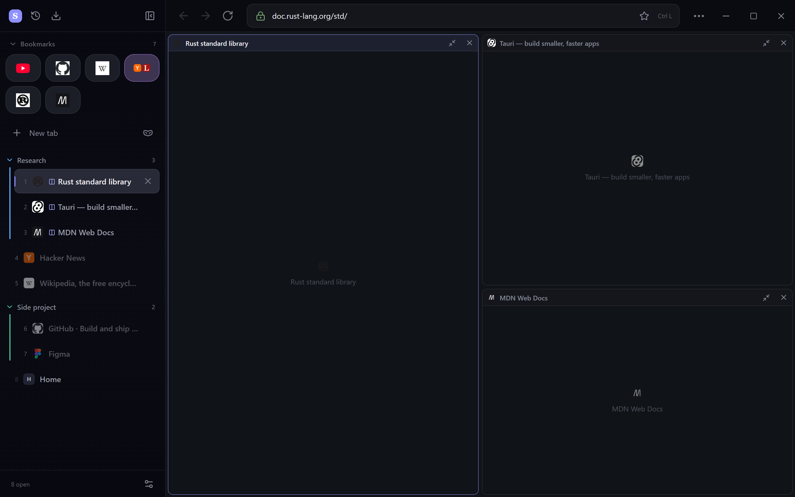
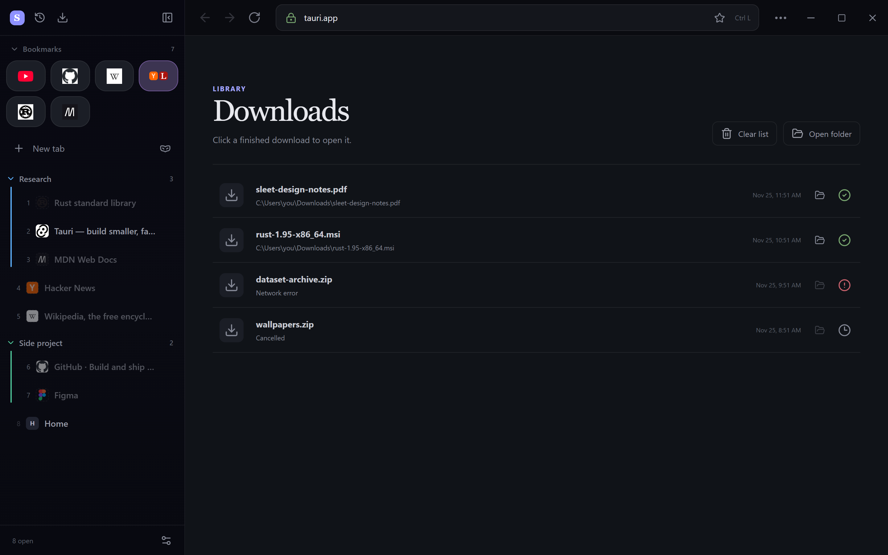
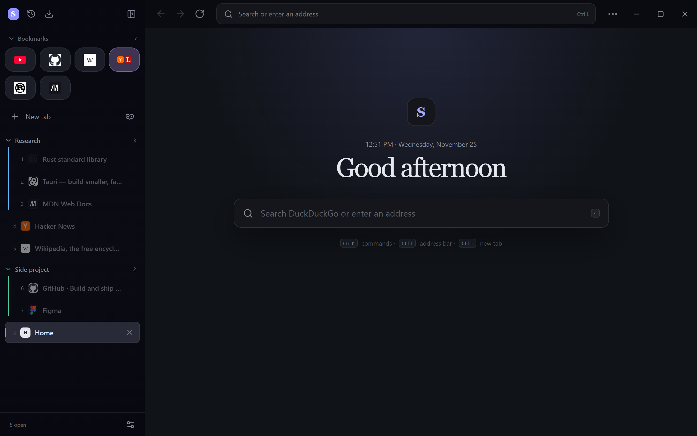
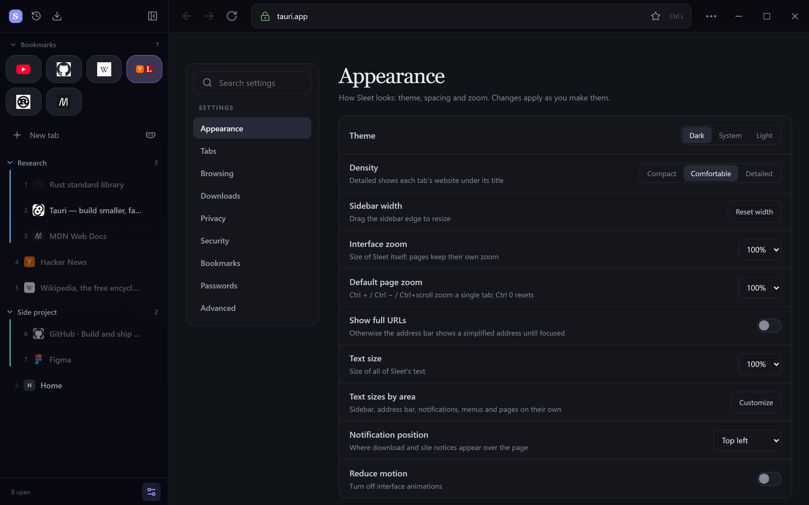

<p align="center">
  
</p>

<h1 align="center">Sleet</h1>

<p align="center">
  A calm, focused desktop browser. Tabs live at the edge, tools arrive when called,<br>
  and everything else gets out of the way.
</p>

<p align="center">
  <a href="https://github.com/HarvestWombs/sleet/releases/latest"><b>Download</b></a> ·
  <a href="#features">Features</a> ·
  <a href="#keyboard">Keyboard</a> ·
  <a href="#building-from-source">Build from source</a>
</p>

<p align="center">
  <picture>
    <source media="(prefers-color-scheme: light)" srcset="docs/screenshots/light.png">
    
  </picture>
</p>

Sleet is built with [Tauri](https://tauri.app) and React. Pages render in the system's own engine (WebView2 on Windows), so it stays small and starts fast, and there is no bundled Chromium.

## Features

### Tabs that stay out of the way

- **Vertical tabs** in a sidebar you can resize, or hide entirely (`Ctrl+Shift+S`).
- **Tab groups** that fold open and closed, with a name and color. Drag tabs in and out, or hold `Ctrl` while dropping one tab on another to group them.
- **Bookmarks** as an icon grid at the top of the sidebar, with folders. Import them from Chrome, Edge, Brave, Vivaldi, Opera, Firefox or Arc.
- **Sleeping tabs:** tabs you haven't used in a while unload to save memory, and background tabs ask the engine to trim theirs.
- **Restore everything** on launch: every window, its tabs, and each tab's back/forward history.

<p align="center">
  
</p>

### Side by side

Drag a tab from the sidebar onto the page and drop it on an edge to **dock** it beside the current one. Split as many ways as you like; each pane has its own title bar to drag, undock or close it, and docked tabs are grouped automatically.

<p align="center">
  
  <br><sub>The browser preview leaves the panes empty; in the app each one shows its page.</sub>
</p>

### More than one window

Open a new window with `Ctrl+N`, or drag a tab out of the sidebar. Drop it on empty space for a new window or onto another Sleet window to move it there; the page keeps running and never reloads.

### Downloads

- Pause, resume and cancel, with progress in the sidebar, the toolbar and a notice in the corner.
- Optionally choose where each file goes, and pick file types to always open when they finish (programs and scripts can never be opened automatically).
- Windows checks risky files; Sleet asks before keeping one it flags, and can remember your answer per file type.

<p align="center">
  
</p>

### Private and secure by default

- **Tracking prevention**, a **popup blocker**, **HTTPS upgrades** and an optional **HTTPS-only** mode.
- **Private tabs** with their own throwaway profile: no history, cookies gone when they close.
- **Per-site permissions** for camera, microphone, location, notifications and more.
- History and downloads stay in a local database on your device. Sleet has no account and no telemetry.
- Optional clearing of history and site data whenever Sleet closes.

### Passwords

A built-in password manager encrypts your logins with **Argon2id** and **XChaCha20-Poly1305**. On a device you choose to remember, the key lives in the system's secure store (Windows Credential Manager, macOS Keychain or the Secret Service), so saving and filling never ask for the master password. Viewing, exporting and changing it still do.

### And the rest

Find in page, print and save as PDF, full-screen video, picture-sharp site icons, links to other apps (`mailto:`, `zoommtg:` …) with a prompt, crash recovery, per-tab zoom, light and dark themes, and signed in-app updates.

<p align="center">
  
  &nbsp;
  
</p>

## Keyboard

| Shortcut | Does |
| --- | --- |
| `Ctrl+L` | Focus the address bar |
| `Ctrl+K` | Command palette |
| `Ctrl+T` / `Ctrl+N` | New tab / new window |
| `Ctrl+Shift+N` | New private tab |
| `Ctrl+W` / `Ctrl+Shift+T` | Close tab / reopen the last closed tab |
| `Ctrl+Tab`, `Ctrl+PgDn` | Next tab (add `Shift`, or `PgUp`, for the previous one) |
| `Ctrl+1` … `Ctrl+9` | Jump to a tab by position (`Alt` + digits types longer numbers) |
| `Alt+←` / `Alt+→` | Back / forward |
| `Ctrl+R`, `F5` / `Esc` | Reload / stop loading |
| `Ctrl+F`, `F3` | Find in page, next match (`Shift` for the previous one) |
| `Ctrl+D` | Bookmark the page |
| `Ctrl+P` | Print |
| `Ctrl+Y` / `Ctrl+J` | History / downloads |
| `Ctrl+=` / `Ctrl+-` / `Ctrl+0` | Zoom in / out / reset |
| `Ctrl+Shift+S` | Show or hide the sidebar |
| `Ctrl+Shift+Delete` | Clear browsing data |
| `Ctrl+,` | Settings |
| `F11` | Full screen |

On macOS, use `Cmd` in place of `Ctrl`.

## Platforms

Sleet is developed on **Windows**, where every feature works. Builds for macOS and Linux are produced too, but a few features are Windows-only for now: pausing downloads, password-form detection and some engine hooks (crash reporting, the download warnings). Contributions for the other platforms are welcome.

## Building from source

You need [Node.js](https://nodejs.org) 20 or newer, Rust (the included `rust-toolchain.toml` selects 1.95 automatically) and the [Tauri prerequisites](https://tauri.app/start/prerequisites/) for your system.

```bash
npm install
npm run tauri dev      # run the app
npm run check          # type check
npm test               # frontend tests
cargo test --manifest-path src-tauri/Cargo.toml
npm run tauri build    # installers in src-tauri/target/release/bundle
```

`npm run dev` alone serves the interface in a regular browser, handy for working on the UI; pages show a placeholder there, since real sites refuse to load in a frame.

### Project layout

| Path | What's there |
| --- | --- |
| `src/` | The interface (React): `App.tsx` holds the browser's state, `components/` the pieces, `lib/` the logic that has tests |
| `src/native/` | The bridge to Tauri, so the rest of the interface doesn't depend on Tauri's (alpha) APIs |
| `src/overlay/` | Small views drawn above pages: notices, menus, suggestions, dialogs |
| `src-tauri/src/` | The native side (Rust): page views, windows, downloads, privacy, the password vault, the history database |
| `.github/workflows/` | CI on every push, and release builds |

## Releasing

GitHub Actions builds everything.

- **CI** (`ci.yml`): every push and pull request runs the type check, frontend tests and Rust tests on Windows, macOS and Linux.
- **Release** (`release.yml`): pushing a `v*` tag builds installers for every platform and attaches them to a **draft** release. Publishing the draft ships it, and installed copies offer the update in Settings → Advanced.

To release, bump `version` in `src-tauri/tauri.conf.json` (the tag must match it), commit, then:

```bash
git tag v0.2.0
git push origin v0.2.0
```

Signed updates need, under the repository's Settings → Secrets and variables → Actions: the secret `TAURI_SIGNING_PRIVATE_KEY` (contents of the private key), the secret `TAURI_SIGNING_PRIVATE_KEY_PASSWORD` (if it has one) and the variable `TAURI_UPDATER_PUBKEY` (contents of the `.pub` file). Make the key once with `npx tauri signer generate -w ~/.tauri/sleet.key` and keep it backed up: without it, installed copies can't be updated. Without these settings, releases still build, just without in-app updates.

## License

[MIT](LICENSE)
